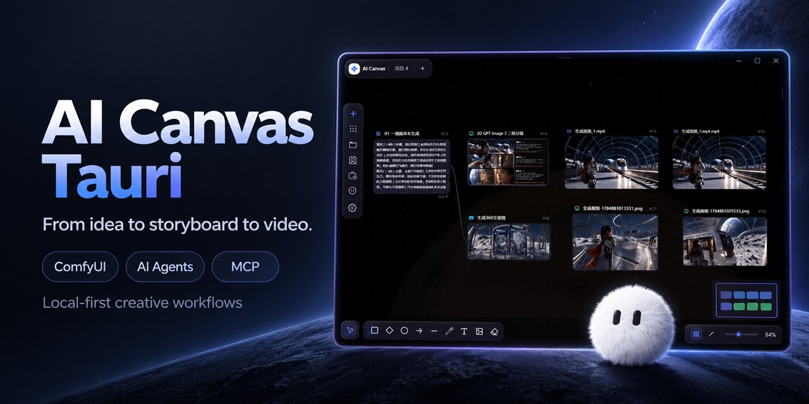

# AI Canvas Tauri — AI Canvas, Short Drama & Asset Management



**Bring ideas, characters, storyboards and videos onto one canvas, with ComfyUI, AI agents and MCP.**

[](https://github.com/Tenney95/AI-Canvas-tauri/stargazers)

**[Live demo](https://tenney95.github.io/AI-Canvas-tauri/) · [Download desktop app](https://github.com/Tenney95/AI-Canvas-tauri/releases) · [Share your work](https://github.com/Tenney95/AI-Canvas-tauri/discussions)**

[简体中文](README.md) · **English** · [日本語](README.ja.md) · [한국어](README.ko.md)

> A local-first AI canvas and visual workflow desktop app for **AI short drama creation, AI asset management, image/video generation and storyboarding**, with **ComfyUI, conversational AI agents and MCP**, built on **Tauri 2 + React 19 + React Flow 12**.

AI Canvas Tauri organizes text, images, video, audio, frame-by-frame animation, Markdown, shot lists, 360° panoramas and hand-drawn notes into connectable canvas nodes. In a single project you can orchestrate generation pipelines, manage characters, scenes, props and local media assets, run ComfyUI workflows, and use the conversational assistant to query or modify the canvas, generate media, dispatch read-only sub-agents, read authorized files, and accumulate project memory. Projects can also be split into series and episodes — each episode of an AI short drama gets its own canvas, while the character library and assets are shared across the whole series.


**Live demo:** <https://tenney95.github.io/AI-Canvas-tauri/> (try it right on the landing page, with a built-in demo canvas)

**Download:** <https://github.com/tenney95/AI-Canvas-tauri/releases> (desktop installers)

[Live demo](https://tenney95.github.io/AI-Canvas-tauri/) · [Download](https://github.com/tenney95/AI-Canvas-tauri/releases) · [Capabilities](#capabilities) · [Getting Started](#getting-started) · [Documentation](#documentation) · [License](#license)

> The web version is ideal for exploring the canvas and interface. File system, credential storage, separate windows, the 3D director desk and local models depend on the Tauri desktop environment; for the full experience, launch the desktop app using the steps below.

## Preview


## Capabilities

| Capability | Description |
| --- | --- |
| Multimodal node canvas | Connect text, images, video, audio, animation, Markdown, storyboards, panoramas, director nodes and canvas notes. |
| Frame animation editing & export | Import or generate sprite sheets, edit animation frames and playback, and export GIFs, PNG sequences or atlases. |
| AI & workflows | Connect cloud and custom models, CCC, multiple ComfyUI servers, RunningHub, generic workflow APIs, Dreamina and local ONNX models. |
| User plugins | Install plugins from local files, the marketplace or GitHub Releases to extend tools, nodes and interfaces. JavaScript runs with restricted capabilities; trusted Python plugins run with your user permissions. |
| Scripts & shot production | Browse source material, write episode scripts, generate and revise shots, and prepare voice and video assets for the editing timeline. |
| Built-in video editing | Arrange multiple tracks and edit clips, transitions, captions, stickers and volume in a separate editor. Supports video export and MCP control. |
| Conversational Agent | Query and edit the canvas, generate media and manage tasks through conversation. Supports multiple conversations, Plan/B/C modes, project memory, separate windows and read-only sub-agents. |
| AI app nodes | Create interactive apps through the Agent or MCP. Apps access only bound canvas assets, run read-only actions and save results. |
| Characters & creative assets | Manage project and global character libraries, reference images, voices and action media, and organize characters, scenes and props. |
| External MCP control | Let external AI tools control the canvas, media and editing projects through local stdio or Streamable HTTP. Disabled by default; remote access requires confirmation to enable. |
| Local storage | Save projects and media locally, and manage API keys in a separate credential store. |
| Series & episodes | Give each episode its own canvas while sharing characters, project memory and assets across the series. |
| Asset library & editing | Manage, preview and edit assets, including prompts, tags, batch prompt extraction from images, text and Markdown. Supports project packages and recoverable deletion. |
| 3D director desk | Build scenes, preview shots and produce video with the lightweight director desk, Blender editing and AI shot previs. |
| Appearance customization | Apply appearance presets across pages, canvas, nodes and edges. Create custom themes and import or export presets. |
| Video batches & usage tracking | Manage video generation batches and export local usage reports for Volcengine Ark image/video nodes. Usage estimates are not official bills. |

Available features depend on the desktop app version. See the [user manual](site/manual.html) for operations and the [module index](doc/文档导航.md) for development and integration documentation (both in Chinese).

## Tech Stack

| Technology | Purpose |
| --- | --- |
| [Tauri 2](https://tauri.app/) + Rust | Desktop shell, windows, files, updates, local models and system capabilities |
| [React 19](https://react.dev/) + TypeScript 6 | UI, domain types and strict type checking |
| [React Flow 12](https://reactflow.dev/) | Node canvas, connections and view controls |
| [Zustand 5](https://zustand.docs.pmnd.rs/) | Slice-based global state management |
| [Tailwind CSS 3](https://tailwindcss.com/) | Component styling and `canvas-*` design tokens |
| [Vitest](https://vitest.dev/) | Automated testing |
| IndexedDB | Local structured data persistence |

## Getting Started

### Prerequisites

- Node.js: meet Vite 8 runtime requirements; current LTS recommended
- npm
- Rust stable toolchain
- Optional Blender editing: Windows x86_64 or macOS Intel/Apple Silicon; stable 4.5 / 5.0 / 5.1 / 5.2 series. The lightweight director desk does not require Blender.
- Platform-specific [Tauri system dependencies](https://v2.tauri.app/start/prerequisites/)

Windows builds additionally require Visual Studio Build Tools 2022 with the "Desktop development with C++" workload installed.

### Install dependencies

```bash
npm install
```

### Start the development environment

```bash
# Start the web frontend only, available at http://localhost:1420 by default
npm run dev

# Start the full Tauri desktop app
npm run tauri dev
```

Web mode is suited for UI development; native dialogs, local file tools, separate windows, local models and the 3D director desk require the Tauri desktop environment.

### Check and build

```bash
# TypeScript type checking
npm run typecheck

# ESLint
npm run lint

# Unit tests (Vitest)
npm run test

# lint + type check + tests
npm run check

# Frontend production build
npm run build

# Desktop app build
npm run tauri build
```

## Documentation

- [User manual (Chinese)](site/manual.html)
- [Module documentation (Chinese)](doc/文档导航.md)
- [开发指南](doc/开发指南.md): environment, commands, directories, conventions, debugging and FAQ (in Chinese)
- [架构说明](doc/架构说明.md): core modules, data flow, security boundaries and performance design (in Chinese)
- [Plugin development guide (Chinese)](doc/插件开发规范.md): manifests, JavaScript/Python runtimes, nodes, UI, permissions and releases
- [ComfyUI 工作流集成说明](doc/ComfyUI工作流集成说明.md): import, IO node detection, content/parameter injection and result retrieval (in Chinese)
- [对话式画布助手功能方案](doc/对话式画布助手-功能方案.md)
- [对话助手 Agent 能力实施方案](doc/对话助手-Agent能力实施方案.md)
- [打包与发版流程](doc/打包与发版流程.md)

Long-term engineering boundaries are defined by [AGENTS.md](AGENTS.md); architecture decision records live in [`doc/adr/`](doc/adr/).

## License

This project is licensed under the **AI Canvas Tauri Source-Available License**; see [LICENSE](LICENSE) for the full terms.

Learning, research, internal use, modification and integration use are permitted. Unauthorized rebranding for sale, white-label distribution, source-code resale, commercial redistribution, and commercializing the project as a competing product are prohibited.

This project is not open source under the OSI definition. For commercial licensing, please contact the copyright holder.

### Third-party assets

The toolbar and properties panel of the canvas note visual design reference [Excalidraw](https://github.com/excalidraw/excalidraw); see [doc/licenses/excalidraw-MIT.txt](doc/licenses/excalidraw-MIT.txt) for its license.

## Contact

Development QQ group: 873354155

## Contributors

<p>
  <a href="https://github.com/zhurui0523" title="zhurui0523"></a>
  <a href="https://github.com/stars-one" title="stars-one"></a>
  <a href="https://github.com/luckcatlin2000" title="luckcatlin2000"></a>
  <a href="https://github.com/Lazzz-y" title="Lazzz-y"></a>
  <a href="https://github.com/xiaozangao" title="xiaozangao"></a>
  <a href="https://github.com/orlova851986-debug" title="orlova851986-debug"></a>
</p>
