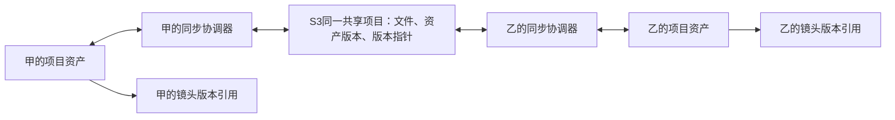

# S3 项目资产共享与匹配方案

状态：用户已确认 P0 的 25 个文件、S3 依赖和主窗口专用权限；P0 已提交。P1 手动同步已实现，用户曾反馈上传失败并继续桌面验证。2026-10-27 用户明确云端清空／删除只处理 RustFS 内容，已据此收敛；隔离测试结果见 8.3，真实云端清理及双客户端仍待验收。P2—P4 尚未实现，自动同步与删除传播仍未启用。

**目标**：多人使用同一个项目／剧集的图片、视频、人物、场景和道具，应用运行时自动同步已纳入共享范围的变更，保留版本、冲突及离线恢复能力。首版仅共享项目资产，不共享全局资产库。

**架构**：各客户端保留本地可用副本；Rust 负责受限 S3 传输，主窗口协调同步、索引与 Store 提交。云端分开保存不可变文件内容、逻辑资产快照和当前版本指针。项目以稳定共享来源绑定资产，不按名称或本机路径猜测。

**技术基础**：现有 Tauri/Rust、文件传输与路径授权、IndexedDB、Zustand、角色资产与归档恢复链。用户已确定首版做通用 S3 兼容接入；S3 客户端依赖在实施前单独评估、确认，不自行手写签名协议。

## 1. 范围与待定项

用户已于 2026-10-26 明确：首版只共享项目资产，不共享全局资产。入口收敛在当前项目／整部剧的资产库，每个本地 owner 必须明确创建或加入一个共享项目资产集合。

- 同步该项目受管文件的原始字节及目录展示信息；图片、视频、音频均支持。
- 同步该项目资产专属提示词、标签、简介，以及项目人物的参考图、主图、头像、声音、主音色、动作及其媒体关联。
- 全局普通文件、全局人物／场景／道具、外部素材目录不建立同步关系。项目生成中尚未提交的临时文件、画布正文、对话、模型、插件与私有配置不因启用项目资产共享而自动上传。
- 项目若引用全局素材，首次对账单独列为外部依赖；经用户确认将该引用的文件、卡片与子项物化为项目资产后才纳入。不扫描或同步整份全局库，也不让全局条目后续变化自动发布到项目共享集合。物化必须同时换成本机项目文件身份、清理全局恢复标记和主图身份，并将实际 `@drama{global/...}` 等引用重映射到项目卡片；不能只复制文件。
- 默认建议删除进入共享回收站；「只同步新增修改、删除不传播」是另一待定选项。
- 首版限定应用运行时同步。退出暂停，重启后先核对队列和远端状态；不承诺退出应用后仍有系统服务同步。
- 共享对象存储与同步不等于画布实时协同。首版不包含多人同时编辑同一张画布、聊天或完整项目正文同步。

## 2. 用户入口

在「项目资产」中增加「启用共享／加入共享项目」入口及同步状态；设置中配置连接、Bucket、项目前缀及本地受管位置。Endpoint、Region、寻址方式、连接 ID 属普通配置，AK/SK/临时凭据只交 Rust 凭据存储。首版不新增全局共享资产库入口。

主要操作：为当前项目创建共享集合、将当前项目连接到已有共享集合、首次发布／合并、立即同步、暂停、重试、查看冲突、版本历史与回收站。资产卡片显示已同步、待上传、下载中、离线、有新版本或冲突；进度不只展示一个全库转圈。

首次连接先展示对账预览：新增多少、可复用多少、哪些仅同名、哪些存在冲突。只有确认加入的范围才进入同步队列。首版的完整离线副本模式自动下载共享范围内的文件；远端清单先到、文件尚未落盘时，不把项目引用标成可用。按需只下载缩略图／已使用资产可作为后续独立选项，不能同时声称已有完整本地备份。

### 2.1 通用 S3 兼容接入（首版已选定）

客户端可直接通过 HTTPS 连接云端提供的 S3 兼容接口，不要求用户先部署 RustFS。自建 RustFS 与云端存储复用同一套项目身份、文件清单和同步决策；只有传输端点与连接参数不同。具体服务仍须通过能力校验，不能把「支持 S3」解释为所有行为一致。

连接入口已在「设置 → 存储 → 项目云同步」，项目创建／加入入口在「资源库 → 项目文件／创作资产 → 项目共享」。P1 在该项目入口提供手动同步预览及应用；自动同步仍为后续方案。

| 配置项 | 用途 |
|---|---|
| 连接名称 | 本机显示名称，不参与资产匹配 |
| Endpoint | 云服务提供的 S3 API 地址，优先 HTTPS；不能使用控制台网页或 CDN 地址代替 |
| Region | 实际服务要求的区域／签名区域，不按 Bucket 名猜测 |
| Bucket | 预先创建且成员有权限的私有存储桶；首版不需要创建或管理整个云账号 |
| Access Key／Secret Key | 成员自己的访问凭据，由 Rust 独占保存和签名使用 |
| Session Token（可选） | 服务提供的临时凭据令牌；到期暂停并提示更新，未接入签发服务前不承诺自动续期 |
| 根前缀 | 应用数据命名空间；实际请求再收敛到 `projects/<sharedProjectId>/` |
| 寻址方式（高级） | Path-style 或 Virtual-hosted，遵循目标服务要求并纳入连接校验 |

接入步骤：

1. 用户在云服务准备私有 Bucket，并给成员分配该项目范围内所需权限。
2. 填写连接参数，先校验地址及读取能力，不要求列出整个云账号或探测其他项目。
3. 为当前项目「创建共享集合」预分配稳定共享项目 ID，或通过非敏感连接信息与共享项目 ID「加入」；每位成员仍需自己配置凭据，此时尚未上传项目资产。
4. 在该共享项目的专用随机探测前缀执行明确标为读写测试的校验，不在云端根目录或别的项目下探测。分别确认列表、读取、原字节写入、分片／取消及条件创建／条件更新，探测对象清理受实际权限限制。多人保护需要证明同一基线的两次竞争更新只有一个成功、旧条件明确失败；只验证上传下载成功不算通过。
5. 显示首次对账预览，确认映射与纳入范围后完成首次同步，再开启自动双向。

云端项目保持私有，不依赖公开读链接。文件下载后继续用本地受管素材与既有模型上传流程；签名 URL 有效期不能成为项目持久引用的一部分。未授权的项目不能因为另一个项目拥有相同哈希就被读取。

首版协议适配器只实现通用 S3。阿里云 OSS 等服务的原生签名／专用接口另列后续适配，不承诺所有厂商换 Endpoint 即可接入。若目标未提供可靠的版本指针原子条件更新，则按现方案拒绝多人自动写入；只读／存储端强制单写或另行设计轻量元数据协调服务，是后续明确选择，不能静默降级为覆盖上传。

## 3. 项目资产怎样匹配

### 3.1 四种身份各司其职

| 层级 | 拟用标识 | 解决的问题 |
|---|---|---|
| 存储命名空间 | `libraryId` | 区分连接到的云端命名空间；不代表需要同步本机全局资产库 |
| 共享项目／剧集资产集合 | 必填 `sharedProjectId` | 哪个项目的资产集合；由用户创建或明确加入，不按项目名称绑定，所有读写必须限定到该项目 |
| 逻辑资产与版本 | `sharedAssetId + revisionId` | 是哪一个人物、场景、道具或文件条目，以及使用哪一版 |
| 内容文件 | 标准 `sha256 + byteLength` | 字节是否相同、上传去重与下载校验 |
| 本地映射 | 现有本机 `assetId`、本地卡片 ID、owner | 文件在这台电脑的位置，以及本项目中的引用身份 |

`sharedProjectId` 只表示共享资产集合，首版不因此同步项目画布正文。本地项目名、目录名与云端文件夹名均是可改的展示信息。

现有 `assetId` 是本机索引主键，项目导入会主动剥离并重新生成，不能直接当作跨成员的共享 ID。人物／场景／道具的逻辑卡片 ID、参考图／声音／动作的子项 ID，也与文件 `assetId` 分开。

示例：两人的本地项目都明确绑定云端命名空间 `L1`、共享项目 `SP1`，使用人物 `C27` 第 `R8` 版。

```text
云端：L1 / SP1 / C27 / R8 → 主图 M1 → 文件 sha256:H

成员甲：本地项目 P-A → 本地人物 A-71 → 文件 assetId F-A
成员乙：本地项目 P-B → 本地人物 B-99 → 文件 assetId F-B

甲、乙的本地 ID 和磁盘位置可以不同；共享来源均为 L1/SP1/C27/R8/M1。
```

同一张图片用于「人物甲」和「人物乙」时，只复用内容文件 `H`；两张卡片的简介、提示词、主音色、版本和共享 ID 仍独立。

### 3.2 拟增加独立绑定表

以下为设计字段，当前代码中尚不存在：

```ts
type SharedAssetOrigin = {
  libraryId: string;
  sharedProjectId: string;
  sharedAssetId: string;
  revisionId: string;
};

type SharedEntityBinding = SharedAssetOrigin & {
  localOwnerId: string; // 当前项目或整部剧的本地 library owner
  localEntityId: string;
};

type SharedMediaBinding = {
  libraryId: string;
  sharedProjectId: string;
  localOwnerId: string;
  sharedMediaId: string;
  revisionId: string;
  contentHash: { algorithm: 'sha256'; value: string };
  byteLength: number;
  localFileAssetId: string;
};
```

绑定表仅登记项目作用域，允许同一共享项目内一份内容被多个资产使用，也允许不同电脑保留独立文件副本。哈希去重、清单查询与读写权限都限定到当前共享项目，不借全局库或另一共享项目的同哈希内容绕过授权。云端只保存共享身份、受限对象 key、展示信息和版本，不保存本机绝对路径、`asset://localhost`、临时授权 URL 或源节点 ID。

项目归档只携带可移植的共享来源；导入生成新项目／剧集身份并重建本机文件身份后，按新 owner 与归档保留的有效卡片／子项身份重建绑定。独立 `.aicassets` 资产包导入则会重分配卡片和子项 ID，需使用其映射结果；默认仍是独立副本，必须显式选择「连接共享资产」才建立后续更新关系。

### 3.3 旧项目首次接入的判定顺序

| 已有材料 | 自动处理边界 |
|---|---|
| 完整共享来源与版本 | 精确匹配同一逻辑资产，并校验实际文件内容 |
| 当前机器已有有效本地 `assetId` | 找到本地文件；还需核对内容是否已被替换 |
| 同一归档的 owner、相对路径和校验摘要 | 在该归档边界内恢复引用，并重建本机身份 |
| 只有标准内容哈希相同 | 可复用文件内容；不能据此自动合并两个人物或两张资产卡片 |
| 只有名称、大小、修改时间或来源 URL 相同 | 仅列候选供确认，不自动绑定、覆盖或删除 |

没有共享来源的旧资产可「发布为新共享资产」，也可明确选择已有共享资产并确认建立映射。批量匹配先显示可信匹配、仅文件可复用、待确认三组，不能把用户点一次「连接存储」解释为全部同名资产自动合并。

分集沿现有 `parentId ?? projectId` 的 library owner 归属整部剧：整部剧维护一份资产集合，各集画布引用它，不为每一集重复上传整套人物。复制项目默认是新项目；可保留资产来源，但不能自动冒充原共享项目的同步实例。

### 3.4 项目资产自动同步与镜头版本策略

项目资产库加入共享后，已纳入范围的新增和修改进入双向自动同步；共享来源映射到该项目的受管文件和项目卡片，保留本地身份与导出链，不经本机全局库中转。新版本使用新内容文件，旧版本保留。

镜头引用的版本策略尚待确认，建议：项目资产库可更新到 R9，但已经用于镜头的引用固定到所选 R8，并提示「有新版本」；用户确认后才更新该镜头。实现时需让节点／`@` 引用记录所选版本并解析对应快照，不能只读取可变的当前卡片 URL。选「独立副本」则脱离同步关系；普通项目资产的已启用同步编辑仍自动发布，无须另走全局共享库。

这避免队友修改主图或音色后，已排好的镜头静默变化；若希望镜头也「跟随最新」，需单独确认，不将此推荐视作用户已选定的行为。

## 4. 双向同步流程



本地 watcher 和应用内资产修改事件只负责提示变化；防抖并等待文件写入稳定后，再计算哈希、与同步基线比较、加入持久队列。启动／恢复窗口／断线重连时做补充对账，不能只依赖 watcher 永不漏事件。

远端首版采用定时清单对账，间隔暂按 15～30 秒设计，加「立即同步」入口；轮询元数据，不反复下载全部文件。通知机制可后续加速，但不能替代对账，因为事件存在重复和乱序，且不同 S3 服务能力不同。

上传顺序：稳定读取 → 内容哈希 → 上传缺少的不可变文件 → 校验 → 写不可变资产快照 → 条件更新当前版本指针 → 记本地成功基线。目录改名与标签修改只产生元数据版本，不重传相同内容；内容变化上传新内容对象，保留旧版。

下载顺序：读版本快照 → 下载缺少文件到暂存区 → 校验大小／哈希 → 在受管位置发布 → 主窗口提交本地文件索引、卡片和绑定 → 通知列表刷新。下载、解码或落盘失败时保留旧版，不发布半套角色；临时文件不显示为已同步资产。

应用退出或崩溃后，队列中「传输中／提交中」不能直接当成功。待办持久记录本次操作 ID、固定 revisionId、基线版本与 baseETag；同一次恢复不另造一个版本。内容对象／快照存在只能证明上传完成，不能证明资产已发布。版本指针更新响应丢失时，重新读取 head：指向本次版本才可确认；若已继续推进，须核对可验证的版本来源链，否则保留结果不确定／冲突状态。head 仍为原基线时才可重试同一次条件提交，不能以快照存在为由更新成功基线或盲目覆盖。下载触发的 watcher 事件通过本次应用版本及哈希核对去重，防止上传下载循环。

## 5. 云端结构与多人冲突

拟用库内结构：

```text
libraries/<libraryId>/projects/<sharedProjectId>/
  project.json
  objects/sha256/<hash>
  revisions/<sharedAssetId>/<revisionId>.json
  heads/<sharedAssetId>.json
```

图片、音频、动作等子素材拥有稳定共享子项 ID，快照中保留主图、主音色和头像指针；每个子项再指向内容对象。对象 key 不是本地文件路径，不得直接拼接落盘。

版本指针更新使用明确的旧 ETag／旧版本前置条件，创建用 `If-None-Match`，更新用 `If-Match`。ETag 在这里是并发令牌，不能当统一内容 SHA-256。目标部署必须验证条件写入语义；缺失时禁用多人自动写入，提供只读或明确单写模式，不能静默退化为最后上传覆盖。

双方都从 R8 开始修改时，第一位成功发布 R9；另一位发布时发现基线变化，保留自己的完整候选版本并进入冲突列表，不覆盖 R9。解决方式为使用云端、使用我的版本、保留为独立新资产；解决后也必须重新检查当前版本。修改与删除同时发生同样作为冲突处理，不使用各电脑时间判断谁较新。

首版建议删除写可恢复的删除版本／墓碑，并让该项目资产视图进入回收站。已有镜头版本和本地独立副本继续可用，不能因为远端删除就删除仍被引用的文件。建议回收保留至少 30 天，首版不自动永久清理；物理清理需确认版本与引用范围，并由有权限的管理操作完成。删除策略和保留时长尚待确认。

因此「双向同步」之外还需要版本历史／回收站才能支持恢复；Bucket 自带版本控制可以作为额外保护，不能替代应用的同步基线与冲突逻辑。

## 6. 已有底座与必要新增

| 已核对的现有入口 | 可复用部分与边界 |
|---|---|
| `services/fs/assetIndex.ts`、`indexedDbService.ts` | 本地稳定文件身份、真实路径与索引；新增独立共享绑定、基线、待办、冲突表，按当前 schema 版本递增 |
| `services/fs/core.ts` | 授权目录 watcher 与磁盘变化通知；需增加应用级对账协调，不逐卡启动同步 |
| `services/dramaAssetTransferService.ts`、`dramaAssetTransferFormat.ts` | 媒体闭包、归档校验、卡片及子项映射；不能直接重复导入 `.aicassets` 充当同步，否则每轮都会产生新身份 |
| `services/projectTransferService.ts`、`storageService.ts` | 相对路径恢复、归档身份重建；需加入可移植共享来源及导入后重新映射 |
| `store/store.utils.ts`、`store.projects.ts` | 剧集 owner、项目切换和既有提交入口；项目写回前复核目标项目／owner／版本，画布写回沿历史和派生守卫 |
| `src-tauri/src/files/transfer.rs` | 流式传输、取消、进度、临时文件与发布模式，已有标准 SHA-256 复制校验；S3 列表、签名、上传及条件请求需要新实现 |
| `src-tauri/src/path_policy.rs`、`secret_store.rs` | 真实调用方与路径授权、凭据原生读取；不得通过同步暴露私有目录 |

特别说明：现有 `AssetIndexRecord.contentDigest` 是 `asset-image-sha256-chain-v1`，不是标准整文件 SHA-256。新清单必须保存摘要算法，已有专用链摘要只能作为已标算法的本地材料，不能冒充云端标准哈希。当前图床上传服务可能读完整 Blob 或重编码图片，不作为原字节备份传输复用。

实现入口包括 `types/assetSync.ts`、`services/fs/sharedAssetSync.ts`、`store/store.assetSync.ts`、设置／同步 UI，以及 `src-tauri/src/files/object_storage/`；各阶段实际状态以第 8 节为准。按阶段确认准确文件清单，不将本方案当作无限扩大改动范围的授权。

## 7. 安全、权限与边界

一个主窗口协调器维护同步状态，独立窗口只发送操作和接收状态。Rust 同步命令限定主窗口及已配置的连接、Bucket、共享项目 ID、项目专属前缀和受管根，不接受通用任意 URL／Header／脚本执行入口；缺少共享项目绑定时拒绝读写，不能回落到云端根目录或本地全局库。

AK/SK/会话令牌只经 Rust `secret_store` 保存和使用，不进入普通配置、IndexedDB、共享清单、日志或项目包。当前凭据底座是受保护本地文件，不能宣称已具备系统级加密。连接分享只导出非敏感参数，成员使用各自被授权的凭据。

本机源／目标仍经过原有 `path_policy`，拒绝符号链接越界、私有目录及其祖先。端点、清单、对象名均作为不可信输入校验；库共享只包含被选中的普通媒体与业务元数据，外部厂商账号、模型／工作流环境绑定和运行权限不随资产自动启用。

首版成员读写能力依赖存储端 IAM／Bucket Policy，界面按钮不构成安全授权。若需要项目级邀请、细粒度成员权限、可靠用户审计或即时推送，再增加团队业务服务；单凭大家共用一把 AK/SK 无法实现可信的人员区分。

## 8. 分阶段实施与验收

| 阶段 | 可审查交付 | 必须核对的结果 |
|---|---|---|
| P0 协议与连接 | 已实现／待验收：S3 连接 UI、当前 owner 创建／加入、独立 catalog 与专用凭据、能力探测和取消 | 目标 RustFS／云端 S3 接口的项目隔离、列表、读写、校验、分片与条件写语义明确；不把「S3 兼容」当全功能保证 |
| P1 手动共享闭环 | 连接、发布／下载、不可变内容与版本、绑定和队列；首次写 head 即强制条件更新与不确定结果恢复，冲突先阻止发布 | 两台电脑路径和本机 ID 不同仍能恢复同一人物、主图、声音、动作；文件原字节一致；并发或回执丢失不能覆盖别人或误报成功 |
| P2 项目精确匹配 | 创建／加入项目资产集合、首次对账、镜头版本引用、全局依赖经确认物化、归档溯源恢复 | 同名不同内容不合并、同图不同角色不合并、分集只一份资产集合、复制项目不冒充原项目；全局条目不产生同步关系 |
| P3 自动双向 | watcher、防抖、定时远端对账、进度、暂停、重启恢复与结果核对 | 修改可自动传递，断网恢复不重复造卡，下载不循环上传，切换项目不错误回填 |
| P4 多人恢复 | 完善已有条件更新的冲突解决界面、删除版本、回收站、权限与平台验收 | 并发修改／修改对删除不丢数据；旧项目版本仍可用；权限失败不伪报成功 |

各阶段实施前展示准确文件、新依赖和权限清单，分别按仓库规则确认。用户已授权开始实施；新依赖及权限仍按仓库检查点单独确认。实现请求不构成自动执行测试或使用用户凭据连接真实远端的授权。

### 8.1 P0 首批实施清单（已确认、已实现／待验收）

交付闭环：设置中保存／修改 S3 连接 → 当前项目／整部剧创建或加入共享项目 → 在该共享项目随机探测目录校验列表、读写、分片和条件写语义 → 保存本机绑定及能力状态。界面明确显示“尚未传输资产”，不将 P0 连接成功宣称为自动同步已完成。删除本机连接或解绑不删除远端资产。

本阶段连接要求 HTTPS 和正常证书验证；不接受重定向、URL 中的认证信息、任意 Header、任意对象路径或环境凭据自动发现。无 TLS 的 RustFS 需要先配置 HTTPS；明文 HTTP 如需支持须另行明确传输边界。

已新增依赖：`object_store = { version = "=0.12.4", default-features = false, features = ["aws"] }`。它提供 S3 签名、流式／分片接口及 ETag 条件写，避免自行实现 SigV4；该版本声明的 MSRV 为 Rust 1.64，使用现有 reqwest 0.12。`aws` 会合并 native-roots 依赖特性；应用仍注入禁重定向、正常 TLS 校验、超时且无自动重试的专用客户端。已解析必要传递依赖并更新锁文件，未进行编译，不能声称编译兼容。最新版 AWS SDK 需要更高 Rust 工具链，rust-s3 缺少满足本阶段要求的 HTTP 客户端注入边界，均不作为首选。依据：[同版本 Cargo 声明](https://raw.githubusercontent.com/apache/arrow-rs-object-store/v0.12.4/Cargo.toml)。

本阶段改动 25 个文件：

| 范围 | 文件 |
|---|---|
| Rust 依赖 | `src-tauri/Cargo.toml`、`src-tauri/Cargo.lock` |
| 原生实现（新增） | `src-tauri/src/files/object_storage/mod.rs`、`src-tauri/src/files/object_storage/client.rs`、`src-tauri/src/files/object_storage/catalog.rs` |
| 原生接入与凭据 | `src-tauri/src/lib.rs`、`src-tauri/src/secret_store.rs` |
| 主窗口专用权限（新增） | `src-tauri/permissions/project-asset-storage.toml`、`src-tauri/capabilities/project-asset-storage.json` |
| 类型、服务与状态 | 新增 `src/types/assetSync.ts`、`src/services/fs/sharedAssetStorage.ts`、`src/store/store.assetSync.ts`；修改 `src/store/useAppStore.ts` |
| 设置入口 | 新增 `src/components/settings/SharedAssetStorageSettings.tsx`；修改 `src/components/SettingsPanel.tsx` |
| 项目入口 | 新增 `src/components/assets/SharedProjectBindingDialog.tsx`；修改 `src/components/AssetsPanel.tsx` |
| 多语言 | `src/i18n/locales/en-US/assetManagement.ts`、`src/i18n/locales/ja-JP/assetManagement.ts`、`src/i18n/locales/ko-KR/assetManagement.ts` |
| 回归用例（新增，不执行） | `tests/services/sharedAssetStorage.test.ts`、`tests/store/sharedAssetStorage.test.ts` |
| 模块与阶段文档 | `doc/文件与存储模块.md`、本方案、`doc/plans/计划索引.md` |

原生命令仅允许 `main`，并在命令内复核实际调用方；连接配置、凭据更新、指定项目创建／加入、能力探测、取消及本机解绑／连接移除均为固定操作，不提供通用 HTTP 或对象删除接口。凭据域 `object-storage/` 仅允许 Rust 内部读写，通用 `secret_get/set/delete` 拒绝访问该域；前端只返回是否已保存。非敏感连接、绑定与探测版本由原生 catalog 持久化，带串行修改及旧版本保护；P0 不改 IndexedDB schema，不将绑定混入可导出的普通项目正文。

能力结果必须绑定连接版本和项目，改连接后失效。条件创建和同一旧 ETag 的竞争更新须证明恰好一方成功，并验证最终内容；不支持时显示不满足多人写入条件，不降级为无条件覆盖。探测内容仅为应用生成的小测试对象和项目描述，不上传本机媒体；探测临时对象清理失败需明确提示，不碰其他项目或资产。取消、关窗或切换项目时撤销本次操作，迟到结果不得绑定新的 owner；结果不确定时保留可恢复状态，不伪报成功。

验收由用户在 Tauri 桌面端执行：深浅主题和小窗口填写连接；留空保留旧凭据、显式替换／清除；同一剧集不同分集共用 owner；两台电脑以共享 ID 加入同一项目；连接变更后旧状态失效；无权限、证书错误、条件写不支持、取消和切项目均保留准确状态。具体命令和异常用例已列入模块文档，当前未运行任何测试或构建。

实际实现入口及验收命令见[文件与存储模块](../文件与存储模块.md)。额外恢复边界：凭据与 catalog 非跨文件事务，落盘部分失败时通过 revision／目标摘要校验失败关闭，可能需要重新填凭据。既有连接修改任一安全目标参数后，先解除本机绑定，再按原共享码重新加入以重新校验；不自动把旧项目切到新 Bucket 或前缀。已删除项目留下的孤立本机绑定可在设置清理，项目目录尚未完成加载时不开放该操作。

验收数据至少包含两个客户端、两套本地目录、相同文件名不同字节、相同字节不同角色、角色多参考图／主音色／动作、两个分集、断线与写入中断。额外覆盖本机旧摘要算法、S3 分片 ETag、恶意路径、切项目、成员无权限和远端目标变化。后续自动化先覆盖纯匹配／对账决策，再覆盖传输模拟与持久化恢复，最后由授权的 Tauri 桌面双客户端验证真实目标存储。

回退：关闭自动同步，保留已落盘文件、项目固定版本及共享来源；队列暂停，不把回退解释为删除本地或云端数据。不得把尚未完成下载／校验的版本设为当前可用版本。

### 8.2 P1 手动双向同步（已实现，待用户验收）

**交付目标**：用户在当前项目资产库看到真实的「立即同步」按钮；先展示本次上传、下载、更新、冲突及未纳入依赖，用户应用后实际传输文件和资产记录。另一客户端加入相同共享码后，可将云端资产下载为自己的本地可用副本。已有绑定与能力校验沿用 P0，不要求重新创建共享项目。

本批复用 `object_store =0.12.4` 和现有文件传输，不新增 npm／Cargo 依赖，不升级工具链，不修改 `tauri.conf.json`，不修改已有四份 `gen/schemas` 工作区改动。由主窗口手动发起；自动轮询、文件 watcher、自动重投、云端删除、回收站、镜头固定版本和共享来源随项目归档迁移仍属后续阶段。

#### 统一入口与依赖方向

业务入口统一为 `services/fs/sharedAssetSync.ts` 的 `projectAssetSyncService`：`preview`、`apply`、`readState` 管理对账、执行和恢复状态，`readProjectFiles`／`projectFileView` 提供本地当前版本视图。界面通过既有 Store Action 发起；Store 不直接访问同步 repository，通用文件服务不反向调用云调度器。

服务内部复用本地文件、卡片和图片专属信息适配，调用 `sharedAssetStorage.ts` 的固定 IPC；Rust 内部负责 S3 请求、字节校验、原生恢复日志与受限路径。格式白名单和数据库事务为内部模块，不是额外同步入口。六个 IPC 保持独立职责以便最小授权，不将它们开放为任意云请求接口。后续自动触发复用本服务，不另建 watcher 调度链或在各节点增加云请求。

统一入口不要求把持久化、原生传输和 UI 合并成大文件。文件清单还包括测试、三语和文档；收敛后保留必要的项目保存队列与权限接点，避免旧保存覆盖下载结果。仅 capability 描述的修改已取消，原窗口集合保持原样。

#### 本批同步内容与匹配

- 以 `seriesOwnerId` 归属整部剧，枚举 owner 和各分集实际受管目录，保留文件的本机分集归属。普通图片、视频、音频以独立 `kind:file` 条目同步；人物、场景、道具分别为逻辑卡片，不能只上传卡片当前主图。
- 卡片闭包包括全部参考图、主图、头像及裁剪、声音及主音色、动作和动作图片／GIF／视频；普通文件包括标签和精确保存的图片专属提示词、参考图及顺序。只按精确图片记录收集其专用参考图附件，不扫描整个附件目录，不从生成历史、画布或对话推断附加信息。
- 全局资产、外部目录、临时／缓存／回收文件、画布正文、聊天、厂商与工作流环境绑定不上传。引用这些内容的项目条目在预览中显示未纳入依赖；不得跳过依赖后仍把该条目标为完整同步。全局依赖物化另阶段确认。
- 映射键包含共享绑定身份、owner、条目 kind 和本地实体 ID。卡片、普通文件及各子项分别拥有稳定共享 ID；动作媒体另绑定所属动作。同名或同字节不合并逻辑资产；标准 SHA-256 仅用于文件内容复用。同步映射在第一次发布前持久化。
- 项目精确扫描只复用当前 owner／分集在原路径的项目身份；新路径分配新身份，不从其他来源的丢失指纹候选自动接管。项目内移动同样不凭指纹认定原身份，需显式修复／迁移；常规扫描入口保持原行为，本批不重写既有自动找回算法。
- 云端使用专用白名单快照，不调用会重分配 ID、剥离引用的 `.aicassets` 导入导出作为同步协议。已映射卡片及参考图／声音／动作／动作媒体更新时保留其本地 ID；新增共享身份才分配新的本地 ID。同项目 `@drama` 引用按完整映射转换；无法移植的引用必须在预览中说明或阻止该条目发布，不能静默降为文字后声称无损。
- 云端只保存共享身份、安全展示名／相对目录、领域文本、文件类型、字节数和标准 SHA-256，不保存本机绝对路径、运行期媒体 URL、来源节点 ID 或源文件路径。输入清单严格限制字段、枚举、长度、数量、嵌套关系和媒体闭包；远端路径不能直接用作本地目标。
- 更新已存在资产需要在同步预览中明确确认。本批保留现有引用解析语义，不宣称镜头已锁定历史版本；不改写画布节点。卡片更换媒体后清理已经失效的来源节点指针，避免旧节点输出遮蔽新卡片媒体；保留其他未共享的本地环境配置。

#### 实施顺序与提交语义

1. **协议和持久化**：P1 从 v23 新增 `sharedAssetMappings`、`sharedAssetOutbox`、`sharedAssetConflicts`；v25 补齐早期 v24 的同步索引，当前 `schema.ts` 为 v26，保留已升级客户端的兼容字段和索引，不降版本。保留旧数据，不重写旧项目。映射保存本地与共享身份、嵌套子项映射、已接受版本、ETag 和规范内容基线；outbox 在远端写入前固定 operationId、revisionId、基线与候选快照，不保存路径和运行句柄。
2. **完整扫描和预览**：普通文件扫描明确返回完整／截断／读取失败状态；默认数量／深度限制不能变成漏传。目录离线、扫描截断、媒体缺失或未纳入依赖时显示具体未完成范围，不能据此推断删除。规范内容摘要忽略本机展示 URL、运行期字段和无内容意义的时间变化。
3. **稳定上传**：通过现有真实路径授权读取已纳入项目的普通文件，暂存固定字节并计算标准 SHA-256。普通文件与卡片可复用同一内容对象，但各自身份与元数据独立。媒体分片上传，所有文件先成功，随后条件创建不可变 revision，最后用原始 baseETag 条件更新 head；一个角色的全部子项成功后才发布该角色。
4. **并发与恢复**：本地未改、远端已改则列下载；本地已改、远端未改则列上传；双方均改或基线不符则保留候选并显示冲突，不强制覆盖。提交回执丢失时检查 head 及有界可验证父链，只有证明本次 revision 已发布才更新基线；仅内容或 revision 对象存在不算成功。恢复使用原 operationId／revisionId，失败或取消后不自动重投。
5. **完整下载和本地应用**：在本轮受管暂存位置下载，逐文件校验大小和标准 SHA-256 后独占发布新文件，保留旧文件。历史版本及暂存内容不重复参加当前文件扫描；当前文件展示由映射投影。所有依赖成功后才应用卡片及元数据，不展示半套可用角色。
6. **原子落库**：下载应用接入现有 owner 项目保存队列的不可合并屏障。先完成旧保存；阻止已捕获的旧快照在同步后覆盖资产，随后保存重新捕获当前状态。相同 IDB 事务提交 owner 资产、项目摘要、文件索引、标签、图片专属记录、映射及 outbox 终态；事务内复核绑定、资产库摘要、文件身份、标签基线、图片记录 revision／内容摘要和既有清理／迁移守卫。事务成功后 Store 一次更新并刷新文件列表，再确认原生暂存收尾。
7. **项目隔离与取消**：沿 P0 操作互斥、连接 revision 和 owner 代数，绑定变更、切项目或关窗均取消运行。每个远端 effect、文件发布和本地应用前重新核对；迟到结果不得写入另一项目。运行状态与取消句柄只在内存，重启后未完成项显示待恢复，不自动宣称成功。

本地图片 `contentDigest` 继续使用既有链摘要算法，下载后按实际内容重建，不能把云端整文件 SHA-256 填入旧字段。文件索引、标签和图片专属信息的并发保护不能仅依赖项目保存屏障，必须在上述事务中分别检查。

#### 原生接口与权限确认项

本批新增以下六个固定 Tauri 命令，继续只允许 `main`，并在原生检查真实调用方。它们从已经校验的共享绑定派生对象范围，不接受任意 Endpoint、Header、对象 key、脚本或输出路径。文件根和本地来源由现有文件服务取得，Rust 再执行 `path_policy` 真实路径授权，并将路径授权与本轮绑定及执行材料关联；恢复时重新授权。

| 新命令 | 固定职责 |
|---|---|
| `project_asset_storage_list_heads` | 有界列出本项目当前版本并校验对应不可变快照，明确分页／完整性 |
| `project_asset_storage_prepare_publish` | 校验纳入范围与本地来源，稳定暂存媒体，生成固定发布材料和标准 SHA-256 |
| `project_asset_storage_publish_revision` | 复核固定材料，上传内容及不可变版本，CAS 提交 head |
| `project_asset_storage_download_revision` | 下载指定共享身份与版本的完整媒体闭包，校验后发布本地受管文件 |
| `project_asset_storage_recover_operation` | 核对原 operation／revision 的真实发布状态，返回成功、待恢复、冲突或不确定 |
| `project_asset_storage_acknowledge_apply` | 主窗口同事务提交成功后，确认该固定下载／应用操作收尾并释放所属暂存 |

继续复用已有 `project_asset_storage_cancel`。原生 journal 仅保存恢复所需的逻辑身份、相对执行材料和分片状态，不保存凭据、绝对路径或运行控制器；暂存路径由宿主派生，不由 Renderer 或远端指定，清理只处理该操作拥有且重新校验的文件。没有通用云端删除命令。

P0 的小对象探测继续保持响应大小和时间限制。媒体传输另使用受限流式模式：仅固定内容读取成功响应可流式读取，元数据和错误响应仍有界；按声明长度、传输字节上限、无进展超时和取消控制，不将大媒体全量读入 Renderer 或取消证书校验。

这六个命令将权限从 P0 连接／探测扩大为实际项目资产上传、下载和版本提交，用户已随本批范围明确确认。capability 的窗口集合仍为 `main`，凭据域及通用文件／网络权限不扩大。

#### 准确文件清单：36 个

以下为最初已确认的 36 文件清单。随后已确认补入 `tests/services/indexedDbService.test.ts`（新增三张表的既有断言）及 `src/components/settings/SharedAssetStorageSettings.tsx`（连接管理说明）。现取消对 `src-tauri/capabilities/project-asset-storage.json` 的纯描述修改，因此实际范围为 37 文件，其中 6 个测试、3 个翻译和 2 个文档；业务源码接点为 26 个，不等于 26 个云服务入口。

| 范围 | 操作与文件 |
|---|---|
| 新增原生实现（4） | `src-tauri/src/files/object_storage/sync.rs`、`src-tauri/src/files/object_storage/protocol.rs`、`src-tauri/src/files/object_storage/journal.rs`、`src-tauri/src/files/object_storage/transfer.rs` |
| 原生接入（4） | 修改 `src-tauri/src/files/object_storage/mod.rs`、`src-tauri/src/files/object_storage/client.rs`、`src-tauri/src/files/transfer.rs`、`src-tauri/src/lib.rs` |
| 主窗口权限（2） | 修改 `src-tauri/permissions/project-asset-storage.toml`、`src-tauri/capabilities/project-asset-storage.json` |
| 类型与 IPC（2） | 修改 `src/types/assetSync.ts`、`src/services/fs/sharedAssetStorage.ts` |
| 新增同步服务（3） | `src/services/fs/sharedAssetSync.ts`、`src/services/sharedAssetSyncFormat.ts`、`src/services/indexedDb/sharedAssetSyncRepository.ts` |
| 数据库与项目保存（3） | 修改 `src/services/indexedDb/schema.ts`、`src/services/indexedDbService.ts`、`src/services/storageService.ts` |
| 文件扫描与图片信息（3） | 修改 `src/services/fileService.ts`、`src/services/fs/assetLibrary.ts`、`src/services/fs/assetImageMetadata.ts` |
| Store（2） | 修改 `src/store/store.assetSync.ts`、`src/store/store.projects.ts` |
| UI（3） | 修改 `src/components/AssetsPanel.tsx`、`src/components/assets/SharedProjectBindingDialog.tsx`；新增 `src/components/assets/SharedProjectSyncPanel.tsx` |
| 多语言（3） | 修改 `src/i18n/locales/en-US/assetManagement.ts`、`src/i18n/locales/ja-JP/assetManagement.ts`、`src/i18n/locales/ko-KR/assetManagement.ts` |
| 新增回归用例（5） | `tests/services/sharedAssetSyncFormat.test.ts`、`tests/services/sharedAssetSyncRepository.test.ts`、`tests/services/sharedAssetSync.test.ts`、`tests/store/sharedAssetSync.test.ts`、`tests/store/projectAssetSyncPersistence.test.ts` |
| 文档（2） | 修改 `doc/文件与存储模块.md`、本方案 |

界面复用 UI Kit 与现有图标，支持深浅主题和紧凑窗口，不新增通用 UI 类；上传／下载数量、当前阶段、可取消进度、最近同步时间、未完成及冲突范围需真实反映任务结果。按钮同时可从当前项目资产工具栏和项目共享设置进入；未绑定或校验失效时导向既有绑定／校验操作。

#### 验收与回退

按仓库规则，本批实现不自动运行测试、lint、类型检查、构建、桌面验收或真实云端调用；先编写上述用例并提供用户操作步骤。用户要求提交时仅自动执行本批变更文件的定向 ESLint。

2026-10-27 实施结果：统一业务 facade、内部完整扫描适配、稳定快照／媒体映射、原生流式传输与 CAS、待办恢复、短期本地应用租约、项目保存屏障和同事务落库均已写入。已编写前端及原生定向用例；仅静态核对，没有执行用例或证明编译通过。分片发起丢失 UploadId 时保留不确定状态，需要存储端清理；祖先证明最多追溯 64 层，超出不猜测成功。镜头固定版本、自动同步、删除传播和归档迁移仍未交付。

兼容修正：v25 补建早期 v24 的同步索引，保留原项目、连接配置、映射和待办；不清库。人物及已保存图片提示词中的画布节点胶囊，仅当能唯一对应当前项目资产时，复用已有转换器转成 `@drama`，再转换共享身份。本机原文保持不变；未知、歧义、全局和厂商／工作流引用仍阻止发布，入站协议不接受本机胶囊。已补迁移与引用回归用例，尚未执行。

2026-10-27 同步失败排查：用户两次尝试均失败；本机待办处于上传阶段，只读查看云端共享项目仅有项目描述文件。旧错误没有记录具体子请求，无法判定失败发生于媒体检查、分片或版本写入，也不能宣称已修复实际上传故障。代码补充固定枚举的脱敏失败阶段和可靠的网络错误分类；本地提交后的回执失败尽力释放原租约，提交结果不确定时保留同一操作与候选版本，避免盲目重投。补充的恢复与脱敏用例未执行。桌面端加载新版原生代码后恢复并核对，若仍失败，根据界面阶段继续定位；验收回执丢失、清理失败和连续恢复时不得覆盖旧内容或重复创建版本。

Tauri 验收：两台电脑、不同本地目录、同一共享码；甲项目文件含未绑卡图片／视频／音频、标签、已保存图片提示词及独立参考图，卡片含多参考图／主音色／动作。甲预览并发布、乙预览并下载，核对原字节与全部指针；再次同步不能重复造卡／文件；修改后只有变化条目参与；同名不同字节、同图不同角色不合并。更新需检查原 `@drama` 胶囊身份和来源节点回退，普通节点保持既有内容。

早期 v24 客户端验收：完整退出所有应用实例后重新打开，原项目、S3 配置和待办仍在；点击「恢复并核对」不再出现同步索引缺失。给人物参考图、动作及图片专属提示词加入本项目资产对应的节点引用，预览应保留其顺序与语义并使用共享身份，本地提示词不改写；未知节点、多个资产共用而无法唯一识别的媒体、全局及模型／工作流引用仍受阻。截图只提供了通用索引错误，未读取用户运行库确认具体缺失索引，实际恢复结论以桌面验收为准。

异常覆盖：分集独立目录、扫描截断／目录离线、媒体缺失、全局／外部依赖、损坏清单、哈希不符、无权限、空间不足、取消、切项目、变更绑定、保存队列旧任务、同步中本地改标签／提示词、双方同时改、head 回执丢失和重启恢复。发生这些情况时保留旧可用内容，不误报完整同步，不凭文件名覆盖，不自动删除。

回退仅关闭／暂停同步入口；保留本地文件、原有项目、原生连接、映射、候选版本和队列，不回退数据库版本，不以清理失败为由删除已发布资产。P1 完成后再按原方案进入 P2 精确匹配／镜头版本和 P3 自动双向；不得把手动同步发布为已具备自动监听。

### 8.3 仅清理 RustFS 云端内容（已实现，待桌面验收）

2026-10-27 用户明确：只清空／删除 RustFS 中当前共享项目的内容，本地文件不动。实现据此收敛，不引入代际切换或跨设备锁，不迁移、删除本地素材、人物资料、索引或同步待办，也不自动解除本机绑定。

入口位于项目共享设置底部：先预览对象数量与大小，确认其他成员已经停止同步，并输入项目名称确认。原生只使用已绑定连接及固定项目专属前缀，短期内存预览 token 绑定范围和对象快照；执行前重新核对快照，变化则要求重新预览。清空保留 `project.json`；删除共享库最后移除 `project.json`，前面的对象删除失败或取消时保留它。逐对象显示实际完成数，失败或取消后重新预览剩余对象，不自动回滚已删除内容。

只删除当前可见对象，不管理 Bucket 历史版本或未知未完成分片。前缀核对和本机任务互斥不等于跨客户端锁；必须让所有成员及外部工具停止写入。历史版本是否释放空间取决于服务端策略。清理不自动重传本地资产；后续同步仍由用户显式发起并核对。

已进入 v26 的本机数据库保持向前兼容，不降版本；兼容字段不作为清理本地资产的依据。本次按用户授权运行本地隔离测试：同步服务、Store、仓储、数据库和清理组件 5 文件 89 项 Vitest 通过；`cargo test --lib --no-default-features --features local-onnx project_asset_storage::` 19 项通过且无 warning，覆盖项目范围、快照变化、清空保留描述符和删除顺序。实际 RustFS 删除、Tauri 界面和跨平台仍待用户验收。测试未连接真实云端。

## 9. 依据与未决事项

- 用户 2026-10-26 请求：多人共享资产库、S3／OSS 双向自动上传下载；随后明确先出方案并说明项目资产匹配。
- 已核对上述本地身份、归档、媒体和原生调用链；未进行功能或性能验证。
- [RustFS 兼容矩阵](https://docs.rustfs.com/en/reference/s3-compatibility) 明确只覆盖受测子集，实际部署仍需探测，不能保证任意 S3 服务全部一致。
- [S3 条件写入](https://docs.aws.amazon.com/AmazonS3/latest/userguide/conditional-writes.html)说明 `If-Match`／`If-None-Match` 的防覆盖语义；[文件完整性](https://docs.aws.amazon.com/AmazonS3/latest/userguide/checking-object-integrity-upload.html)区分校验方式，不能统一把 ETag 当内容 SHA-256。
- [S3 事件结构](https://docs.aws.amazon.com/AmazonS3/latest/userguide/notification-content-structure.html)明确通知不保证到达顺序；首版用定时对账，不承诺依赖通知实现零延迟同步。
- [RustFS SDK 说明](https://docs.rustfs.com/en/developer/sdk)与[腾讯 COS 的 S3 通用配置](https://intl.cloud.tencent.com/document/product/436/34688?lang=en)可作为适配验证材料，不能替代实际目标部署的条件写验收。原生 OSS 接口的[寻址与签名要求](https://www.alibabacloud.com/help/en/oss/developer-reference/overview-24)不同，后续单独适配。
- 已确认：目前仅共享项目资产，不共享全局资产；分集按现有整部剧 owner 组织资产，所有读写与去重限定共享项目。
- 已确认：首版先做通用 S3 兼容接入；云服务经该接口连接，自建 RustFS 也使用同一协议，不同时展开各厂商原生接口。
- 待用户确认：删除传播策略与回收期限；固定版本是否作为镜头默认；是否需要首版即支持成员级业务权限。其余推荐值均为方案，尚未生效。
